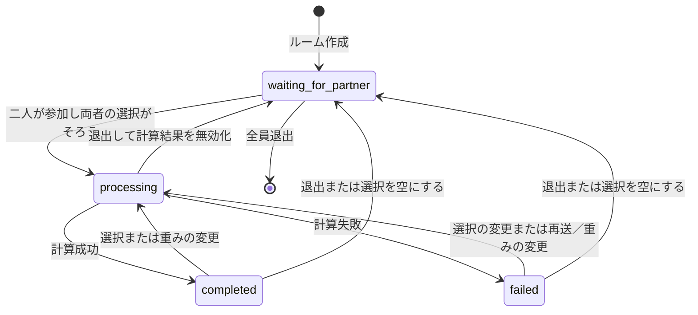
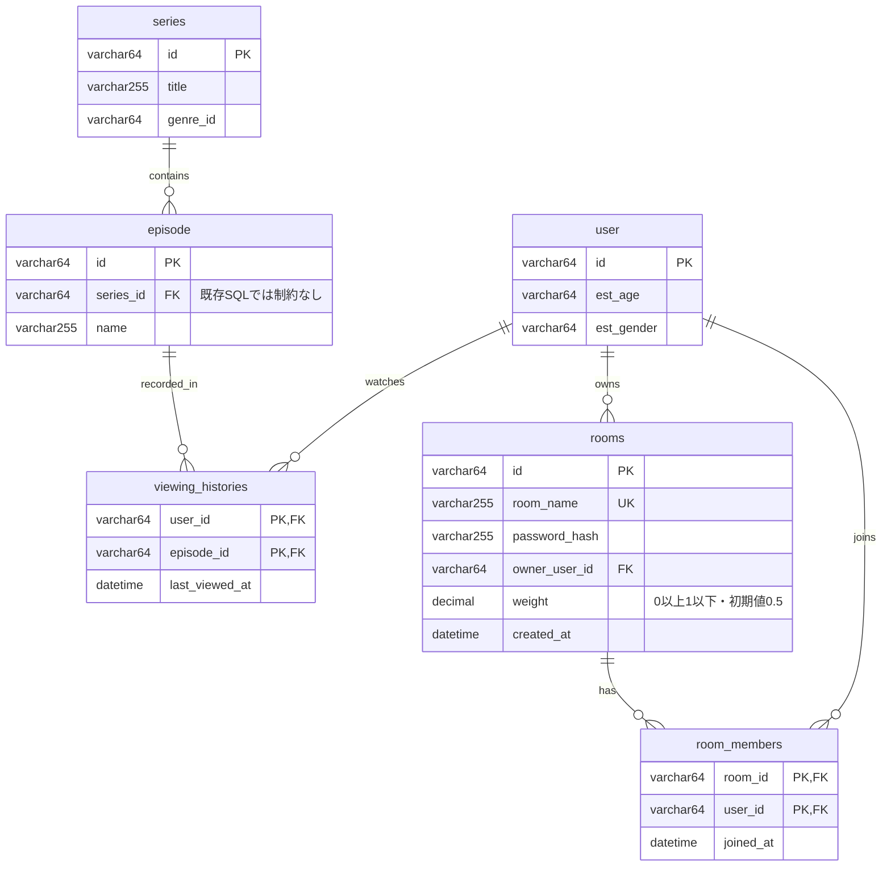

# 二人向け番組推薦システム設計

## 1. 目的と対象範囲

二人のユーザーが、それぞれの視聴履歴から推薦に使う番組を選び、二人で楽しめる番組を最大10件取得する。ルームへの参加はルーム名とパスワードを共有して行う。スライダーで二人の好みの重みを変更できる。

## 2. 利用の流れ

1. ログイン済みユーザーがルームを作成する。
2. 相手がルーム名とパスワードで参加する。定員は二人。
3. 各参加者が視聴履歴を取得し、推薦に使う番組を選んで送信する。
4. 二人分の選択がそろったら、サーバーが推薦を計算する。
5. WebSocketで両者に推薦結果を通知する。
6. 選択や重みを変更すると再計算する。
7. 退出時は選択と結果を無効化し、残る参加者に通知する。

## 3. API仕様（Swagger形式）

リクエスト・レスポンス、認証、入力型、エラーは **[openapi.yaml](openapi.yaml)** を正本とする。OpenAPI 3.0.3形式で、Swagger Editor / Swagger UIに読み込める。

| メソッド | パス | 用途 | 成功時 |
|---|---|---|---|
| POST | `/rooms` | ルーム作成・作成者の参加 | 201 |
| POST | `/rooms/join` | ルームに参加 | 200 |
| GET | `/rooms/{room_id}/members/{user_id}/viewing-history` | 参加者の視聴履歴取得 | 200 |
| PUT | `/rooms/{room_id}/members/{user_id}/viewing-history` | 自分の推薦用選択を全件置換 | 200 / 202 |
| POST | `/rooms/{room_id}/preference` | 重み変更 | 200 |
| DELETE | `/rooms/{room_id}/members/{user_id}` | 自分の退出 | 204 |
| GET | `/rooms/{room_id}/ws` | WebSocket接続 | 101 |

## 4. 状態管理とWebSocket

ルーム作成・参加レスポンスの`waiting` / `ready`は、人数が一人 / 二人であることを表す。通知の`members[].ready`は、各参加者が推薦入力を送信済みかを表す。人数と推薦処理の状態は分けて扱う。

失敗後は同じ選択の再送も再試行として受け付ける。相手の選択が未送信なら、重み変更後も`waiting_for_partner`のままにする。

接続先は`/rooms/{room_id}/ws`。接続前にセッションと参加資格を確認し、成功時は101で接続を切り替える。接続後はサーバーからJSONテキストを送る。

| イベント | 通知する内容 | タイミング |
|---|---|---|
| `room.updated` | room_id、参加者とready、推薦処理のstatus | 接続直後、参加・退出、選択・重み・処理状態の変更 |
| `recommendation.completed` | room_id、推薦順のitems（最大10件） | 計算完了、完了状態での再接続 |
| `recommendation.failed` | room_id、error.code、error.message | 計算失敗、失敗状態での再接続 |

各イベントのスキーマはOpenAPIの`components.schemas`に定義し、接続パスの`x-websocket-events`から参照する。この拡張は通知の資料用であり、OpenAPI標準によるWebSocketプロトコルの定義ではない。

接続・再接続時は現在の`room.updated`を送り、状態に応じて最新結果または失敗情報も送る。切断中のイベントの再送は行わない。WebSocket切断だけでは退出扱いにしない。退出したユーザーの接続は閉じる。

## 5. DB設計（ER図）

`user`、`series`、`episode`は既存テーブル。`viewing_histories`、`rooms`、`room_members`は追加案。既存SQLには外部キー制約がないため、`episode.series_id`の線は論理上の関係を示す。新規テーブルのFKは追加する案であり、この資料ではマイグレーションは行わない。

### テーブルの役割と制約

| テーブル | 役割・制約 |
|---|---|
| `user` | 既存ユーザー情報。年齢・性別は既存の推定値 |
| `series` | 番組情報。`genre_id`に対応するマスターは既存SQLにないため図には追加しない |
| `episode` | 番組に属するエピソード |
| `viewing_histories` | ユーザーごとの視聴済みエピソード。複合主キーで一件にまとめ、再視聴は最終視聴日時を更新する案 |
| `rooms` | ルーム名、パスワードハッシュ、作成者、重み。平文パスワードは保存しない |
| `room_members` | ルームと参加者の関連。同一ルームへの重複参加を複合主キーで防ぐ |

視聴履歴APIの番組一覧は`viewing_histories → episode → series`で取得する。履歴の検索用に`viewing_histories(user_id, episode_id)`、参加ルームの検索用に`room_members(user_id, room_id)`を利用する。ルーム削除時は所属メンバーも削除する。

定員二人はER図の多重度だけでは保証できない。参加処理はトランザクションで対象ルーム行をロックし、人数を確認して挿入する。同時参加でも三人目を受け付けない。作成者は参加者の一人であることをアプリケーションで保証する。

退出時はその参加者の選択と最新結果を無効化する。作成者が退出し相手が残る場合は所有者を引き継ぎ、重みを0.5に戻す。全員退出したルームは削除する。

## 6. 推薦入力・結果の保存方針（暫定案）

初期実装はサーバー一台を前提とする。

| 保存先 | 対象 |
|---|---|
| MySQL | 既存マスター、視聴履歴、ルーム、参加者、重み |
| プロセスメモリ | ルーム単位の選択ID、各参加者のready、推薦処理状態、最新結果・失敗情報、計算世代番号 |

DBの視聴履歴と、ルーム内で選んだ推薦入力は別物として扱う。選択PUTで元の視聴履歴を書き換えない。最新結果をメモリに保持して、同じプロセスへの再接続時に返す。

ルーム単位で選択更新と計算開始を排他制御し、同時送信で計算が二重に起動しないようにする。計算開始時に選択・重み・参加者のスナップショットと世代番号を取得する。退出で世代が変わった場合は古い計算結果を破棄する。

サーバー再起動時は選択と結果が消える。DBに残るルームへ再接続した場合は`waiting_for_partner`、両者の`ready=false`から再送を受け付ける。複数サーバー構成や再起動後の入力復元が必要になった場合は、共有ストレージ（RedisまたはDB）への移行を検討する。
